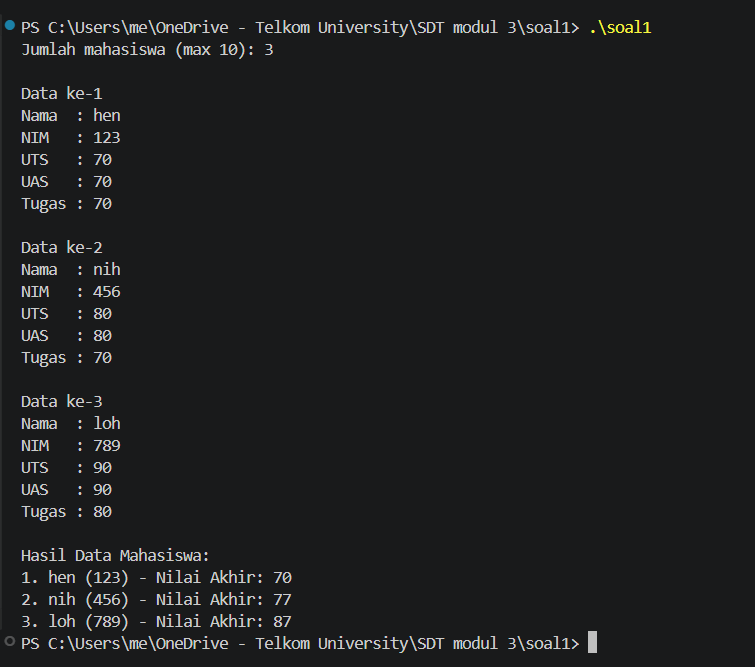
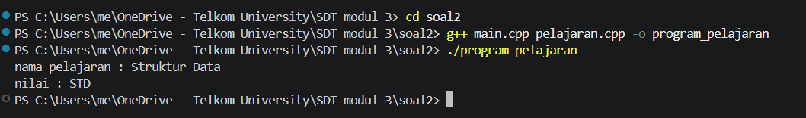
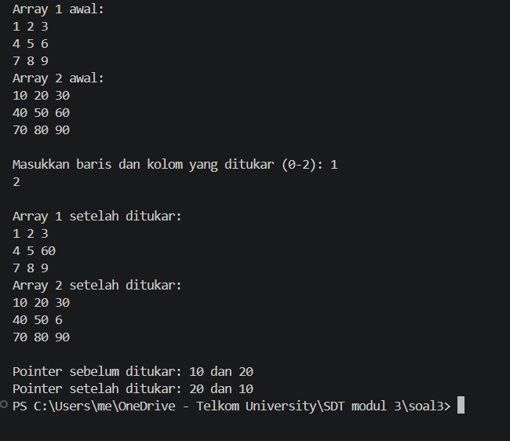

# <h1 align="center">Laporan Praktikum Modul 3 - Abstract Data Type (ADT)</h1>
<p align="center">Ignatius Steven Manurung - 109082500089</p>

## Dasar Teori
Abstract Data Type (ADT) merupakan tipe data bentukan beserta operasi dasarnya yang dalam C++ direpresentasikan menggunakan struct, kemudian dipisahkan ke dalam file header (.h), implementasi (.cpp), dan program utama (main.cpp). Untuk menyimpan sekumpulan data secara terstruktur digunakan array, baik satu dimensi untuk menampung kumpulan struct maupun dua dimensi untuk data berbentuk matriks. Pengolahan datanya didukung oleh pointer untuk mengakses alamat memori variabel secara langsung, fungsi untuk mengembalikan nilai hasil perhitungan, serta prosedur untuk menjalankan perintah tanpa nilai balik seperti menampilkan atau menukar data. 

## Unguided 

### 1. Buat program yang dapat menyimpan data mahasiswa (max. 10) ke dalam sebuah array dengan field nama, nim, uts, uas, tugas, dan nilai akhir. Nilai akhir diperoleh dari FUNGSI dengan rumus 0.3 * uts+0.4 * uas+0.3 * tugas.

```C++
#include <iostream>
#include <string>

using namespace std;

struct Mahasiswa {
    string nama, nim;
    float uts, uas, tugas, nilaiAkhir;
};

float hitungNilaiAkhir(float uts, float uas, float tugas) {
    return 0.3 * uts + 0.4 * uas + 0.3 * tugas;
}

int main() {
    Mahasiswa mhs[10];
    int n;

    cout << "Jumlah mahasiswa (max 10): ";
    cin >> n;

    for (int i = 0; i < n; i++) {
        cout << "\nData ke-" << i + 1 << endl;
        cout << "Nama  : ";
        getline(cin >> ws, mhs[i].nama);
        cout << "NIM   : ";
        cin >> mhs[i].nim;
        cout << "UTS   : ";
        cin >> mhs[i].uts;
        cout << "UAS   : ";
        cin >> mhs[i].uas;
        cout << "Tugas : ";
        cin >> mhs[i].tugas;

        mhs[i].nilaiAkhir = hitungNilaiAkhir(mhs[i].uts, mhs[i].uas, mhs[i].tugas);
    }

    cout << "\nHasil Data Mahasiswa:\n";
    for (int i = 0; i < n; i++) {
        cout << i + 1 << ". " << mhs[i].nama << " (" << mhs[i].nim << ") - Nilai Akhir: " << mhs[i].nilaiAkhir << endl;
    }

    return 0;
}
```
### Output Unguided 1 :

##### Output 1


Program ini menggabungkan tipe data bentukan struct Mahasiswa dengan array satu dimensi berkapasitas maksimal 10 elemen untuk menyimpan data nama, NIM, nilai UTS, UAS, tugas, serta nilai akhir. Perhitungan nilai akhir dipisahkan ke dalam fungsi hitungNilaiAkhir yang menerima parameter nilai UTS, UAS, dan tugas, lalu mengembalikan hasil pembobotan sesuai rumus 0.3 x uts + 0.4 x uas + 0.3 x tugas.

### 2. Buatlah ADT pelajaran

```C++
//pelajaran.h
#ifndef PELAJARAN_H_INCLUDED
#define PELAJARAN_H_INCLUDED

#include <iostream>
#include <string>

using namespace std;

struct pelajaran {
    string namamapel;
    string kodemapel;
};

pelajaran create_pelajaran(string namapel, string kodepel);
void tampil_pelajaran(pelajaran pel);

#endif

//pelajaran.cpp
#include "pelajaran.h"

pelajaran create_pelajaran(string namapel, string kodepel) {
    pelajaran p;
    p.namamapel = namapel;
    p.kodemapel = kodepel;
    return p;
}

void tampil_pelajaran(pelajaran pel) {
    cout << "nama pelajaran : " << pel.namamapel << endl;
    cout << "nilai : " << pel.kodemapel << endl;
}

//main.cpp
#include <iostream>
#include "pelajaran.h"

using namespace std;

int main() {
    string namapel = "Struktur Data";
    string kodepel = "STD";
    pelajaran pel = create_pelajaran(namapel, kodepel);
    tampil_pelajaran(pel);
    return 0;
}
```
### Output Unguided 2 :

##### Output 1


Program ini menerapkan pemisahan modul ADT ke dalam tiga file terpisah dalam satu proyek. File pelajaran.h berisi spesifikasi struct pelajaran beserta deklarasi primitifnya, file pelajaran.cpp berisi realisasi isi dari fungsi konstruktor create_pelajaran dan prosedur tampil_pelajaran, sedangkan main.cpp bertindak sebagai program utama (driver) untuk membentuk dan menampilkan objek mata pelajaran.

### 3. (isi dengan soal unguided 3)

```C++
#include <iostream>

using namespace std;

void tampilArray(int arr[3][3]) {
    for (int i = 0; i < 3; i++) {
        for (int j = 0; j < 3; j++) {
            cout << arr[i][j] << " ";
        }
        cout << endl;
    }
}

void tukarArray(int arr1[3][3], int arr2[3][3], int baris, int kolom) {
    int temp = arr1[baris][kolom];
    arr1[baris][kolom] = arr2[baris][kolom];
    arr2[baris][kolom] = temp;
}

void tukarPointer(int *ptr1, int *ptr2) {
    int temp = *ptr1;
    *ptr1 = *ptr2;
    *ptr2 = temp;
}

int main() {
    int arr1[3][3] = {{1, 2, 3}, {4, 5, 6}, {7, 8, 9}};
    int arr2[3][3] = {{10, 20, 30}, {40, 50, 60}, {70, 80, 90}};

    int a = 10, b = 20;
    int *p1 = &a, *p2 = &b;

    cout << "Array 1 awal:\n";
    tampilArray(arr1);
    cout << "Array 2 awal:\n";
    tampilArray(arr2);

    int baris, kolom;
    cout << "\nMasukkan baris dan kolom yang ditukar (0-2): ";
    cin >> baris >> kolom;
    tukarArray(arr1, arr2, baris, kolom);

    cout << "\nArray 1 setelah ditukar:\n";
    tampilArray(arr1);
    cout << "Array 2 setelah ditukar:\n";
    tampilArray(arr2);

    cout << "\nPointer sebelum ditukar: " << *p1 << " dan " << *p2 << endl;
    tukarPointer(p1, p2);
    cout << "Pointer setelah ditukar: " << *p1 << " dan " << *p2 << endl;

    return 0;
}
```
### Output Unguided 3 :

##### Output 1


Program ini mengolah dua buah array dua dimensi berukuran 3 x 3 dan dua buah pointer integer melalui tiga prosedur. Prosedur tampilArray menampilkan isi matriks menggunakan perulangan bersarang, tukarArray menukar nilai elemen pada indeks baris dan kolom tertentu antar kedua array menggunakan variabel sementara (temp), dan tukarPointer menukar isi dua variabel integer secara langsung melalui alamat memori yang ditunjuk oleh kedua pointer.

## Kesimpulan
Penerapan konsep Abstract Data Type (ADT) dalam bahasa C++ memisahkan spesifikasi tipe data bentukan (struct) dan deklarasi primitif pada file header (.h) dari realisasi kodenya pada file implementasi (.cpp) serta program utama (main.cpp), sehingga struktur program menjadi lebih modular dan terorganisasi. Pengelolaan data majemuk juga menjadi lebih efektif melalui kombinasi array satu dimensi dengan struct untuk menyimpan sekumpulan rekaman data, maupun array dua dimensi untuk merepresentasikan data berbentuk matriks. Selain itu, penggunaan fungsi, prosedur, dan pointer mempermudah pemrosesan data secara terpisah serta memungkinkan manipulasi dan pertukaran nilai variabel secara langsung melalui alamat memorinya.

## Referensi
Deitel, P., & Deitel, H. (2017). C++ How to Program (10th ed.). Hoboken: Pearson.

Malik, D. S. (2018). Data Structures Using C++ (2nd ed.). Boston: Cengage Learning.

Munir, R. (2016). Algoritma dan Pemrograman dalam Bahasa Pascal, C, dan C++. Bandung: Informatika.
